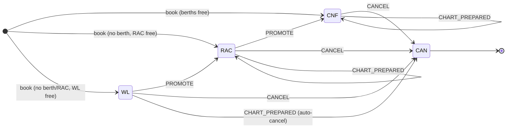
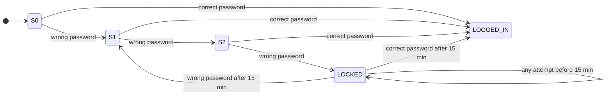

# State Transition Testing

**Idea:** when behaviour depends on the **history** of events, model the system as states and
transitions, then test (a) every valid transition ("0-switch coverage"), (b) every invalid
event in every state, and (c) meaningful sequences of transitions ("1-switch" paths).

Two state machines exist in RailReserve:

1. **Ticket status** - `app/src/lib/ticketState.ts`, driven by booking, cancellation, promotion and chart preparation.
2. **Login lock-out** - `app/src/lib/auth.ts`.

Automated in [`stateTransition.test.ts`](../05_Test_Automation/unit-tests/stateTransition.test.ts);
the transitions are also exercised through the real reservation engine (`reservation.test.ts`,
`mutationGaps.test.ts`) and through the browser (`TC_E2E_17`, `TC_E2E_20`, `TC_E2E_10`).

---

## 1. Ticket status

### 1.1 State diagram

States: **CNF** Confirmed · **RAC** Reservation Against Cancellation · **WL** Waitlisted · **CAN** Cancelled (final).
Events: **PROMOTE** (a seat was freed by a cancellation, FIFO) · **CANCEL** (by the passenger) · **CHART_PREPARED** (4 h before departure).

### 1.2 State table (rows = current state, columns = event)

| State \ Event | PROMOTE | CANCEL | CHART_PREPARED |
|---|---|---|---|
| **WL** | RAC (T1) | CAN (T3) | CAN (T6) |
| **RAC** | CNF (T2) | CAN (T4) | RAC (T7) |
| **CNF** | ✗ invalid (I1) | CAN (T5) | CNF (T8) |
| **CAN** | ✗ invalid (I2) | ✗ invalid (I3) | ✗ invalid (I4) |

### 1.3 Test cases

| Test case | Type | Start state | Event(s) | Expected |
|---|---|---|---|---|
| TC_ST_TKT_01 | valid T1 | WL | PROMOTE | RAC |
| TC_ST_TKT_02 | valid T2 | RAC | PROMOTE | CNF |
| TC_ST_TKT_03 | valid T3 | WL | CANCEL | CAN |
| TC_ST_TKT_04 | valid T4 | RAC | CANCEL | CAN |
| TC_ST_TKT_05 | valid T5 | CNF | CANCEL | CAN |
| TC_ST_TKT_06 | valid T6 | WL | CHART_PREPARED | CAN |
| TC_ST_TKT_07 | valid T7 | RAC | CHART_PREPARED | RAC |
| TC_ST_TKT_08 | valid T8 | CNF | CHART_PREPARED | CNF |
| TC_ST_TKT_09 | invalid I1 | CNF | PROMOTE | InvalidTransitionError |
| TC_ST_TKT_10 | invalid I2 | CAN | PROMOTE | InvalidTransitionError |
| TC_ST_TKT_11 | invalid I3 | CAN | CANCEL | InvalidTransitionError |
| TC_ST_TKT_12 | invalid I4 | CAN | CHART_PREPARED | InvalidTransitionError |
| TC_ST_TKT_13 | message | CAN | CANCEL | "Invalid transition: CANCEL is not allowed for a Cancelled ticket" |
| TC_ST_TKT_14 | sequence | WL | PROMOTE, PROMOTE, CANCEL | WL → RAC → CNF → CAN |
| TC_ST_TKT_15 | sequence | RAC | CHART_PREPARED, CANCEL | RAC → RAC → CAN |
| TC_ST_TKT_16 | sequence | WL | CANCEL, PROMOTE | error on the 2nd event (no revival) |

Coverage: **8/8 valid transitions, 4/4 invalid state-event pairs**, plus 3 multi-step paths.

### 1.4 The same machine driven by the real reservation engine

| Test case | Scenario | Transitions exercised |
|---|---|---|
| TC_UT_BOOK_02 | three 2-passenger bookings on 12951 1A | [*]→CNF, [*]→RAC, [*]→WL, then REGRET |
| TC_UT_CAN_01 | cancel the CNF ticket | CNF→CAN, RAC→CNF (T2), WL→RAC (T1) |
| TC_UT_CAN_02 | cancel the RAC ticket | RAC→CAN, WL→RAC |
| TC_UT_CAN_03, TC_UT_MUT_17 | not enough space freed | no promotion (strict FIFO) |
| TC_UT_MUT_15 | promoted ticket gets the freed berth (H1/2), not its old RAC number | T2 with re-allocation |
| TC_UT_MUT_16 | FIFO by booking time, not list order | T2 for the oldest RAC |
| TC_UT_CHART_02 | chart at 3.5 h before departure | T8, T7, T6 (WL auto-cancelled, refund − clerkage) |
| TC_UT_CHART_03 | chart run twice, cancelled ticket | idempotent, CAN untouched |
| TC_E2E_17 (browser) | book 3 times on 12951 1A | Confirmed → RAC → Waitlisted → REGRET |
| TC_E2E_20 (browser) | cancel CNF | CNF→CAN, RAC→CNF visible in My Bookings |

---

## 2. Login lock-out

### 2.1 State diagram

S0/S1/S2 = 0/1/2 consecutive failures. A successful login resets the counter.

### 2.2 Test cases

| Test case | From | Event | To | Shown to user |
|---|---|---|---|---|
| TC_ST_LOGIN_01 | S0 | correct | LOGGED_IN | - |
| TC_ST_LOGIN_02 | S0 | wrong | S1 | "2 attempt(s) left" |
| TC_ST_LOGIN_03 | S1 | wrong | S2 | "1 attempt(s) left" |
| TC_ST_LOGIN_04 | S2 | wrong | LOCKED (+15 min) | "Account locked…" |
| TC_ST_LOGIN_05 | S2 | correct | LOGGED_IN, counter reset | - |
| TC_ST_LOGIN_06 | LOCKED | correct, before expiry | LOCKED | "Account locked…" |
| TC_ST_LOGIN_07 | LOCKED | wrong, before expiry | LOCKED (not extended) | "Account locked…" |
| TC_ST_LOGIN_08 | LOCKED | correct, 1 ms before expiry (BVA) | LOCKED | |
| TC_ST_LOGIN_09 | LOCKED | correct, exactly at expiry (BVA) | LOGGED_IN | |
| TC_ST_LOGIN_10 | LOCKED | wrong, after expiry | S1 | "2 attempt(s) left" |
| TC_ST_LOGIN_11 | S0 | wrong × 3 | INVALID, INVALID, LOCKED | |
| TC_IT_12 | S0 | (component) wrong × 3, then correct | LOCKED | messages verified in the rendered page |
| TC_E2E_10 | S0 | (browser) wrong × 3, then correct | LOCKED | messages verified in Chrome |

Coverage: all 10 transitions of the diagram, including both sides of the 15-minute expiry boundary.
