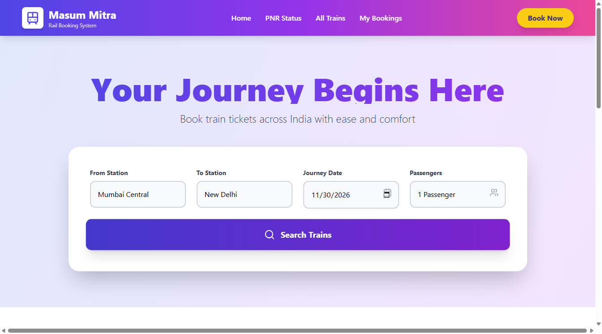
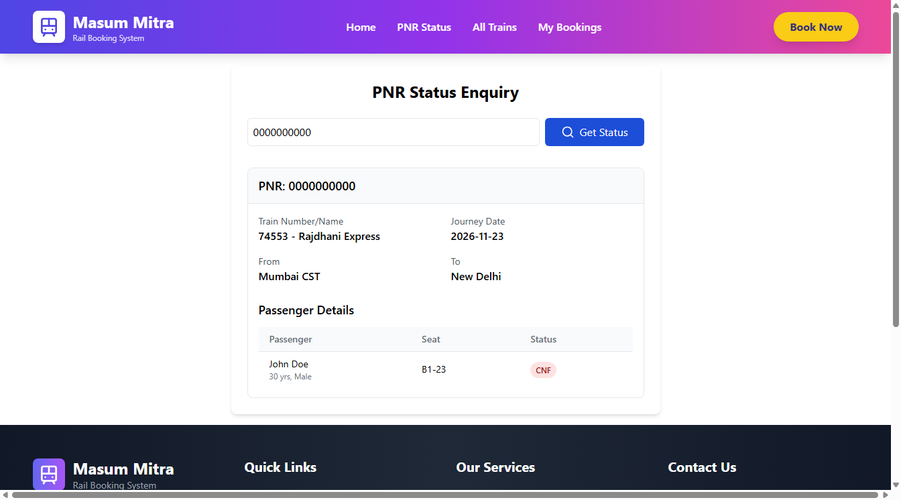
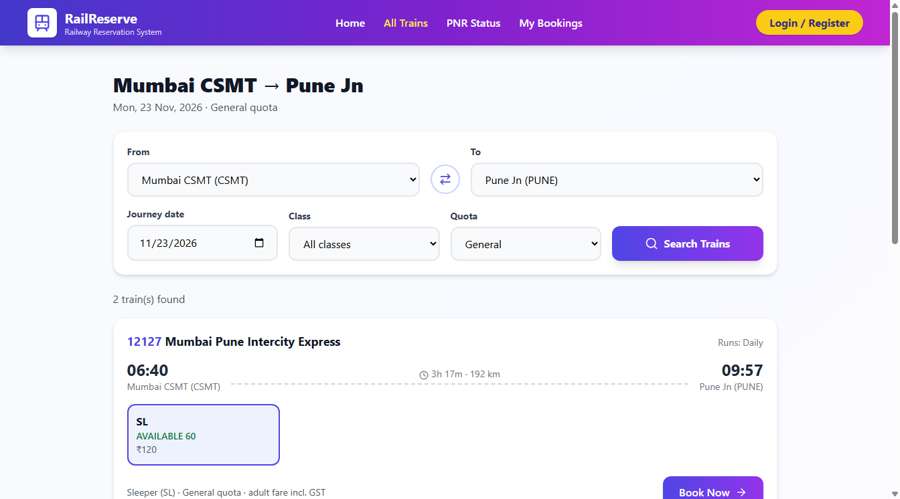
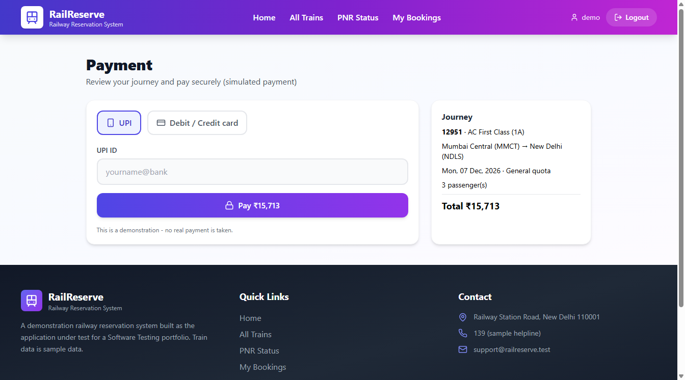
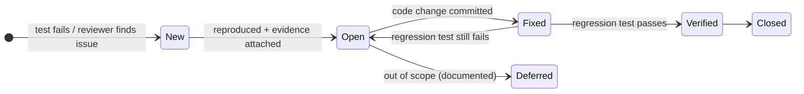

# Defect Report

| Item | Detail |
|---|---|
| Project | RailReserve - Railway Reservation System |
| Builds tested | **v1.0** original irctc-clone (commit `e108a38`, run on port 5174) · **v2.0** improved app (`app/`, port 5173) |
| Environment | Windows 11, Chrome 158 (headless), Node 24, Python 3.12, Selenium 4.54 |
| Date | 2026-11-23 |
| How found | Selenium baseline probe (`V1-Dxx`), static testing (tsc / ESLint / code review), E2E suite run #1 on v2.0, code review |

## 1. Summary

| ID | Title | Build | Module | Severity | Priority | Found by | Status |
|---|---|---|---|---|---|---|---|
| [D01](#d01) | "Search Trains" on the home page does nothing | v1.0 | Search | Critical | P1 | Probe V1-D01 | Fixed in v2.0 · verified |
| [D02](#d02) | Identical source and destination accepted | v1.0 | Search | Medium | P2 | Probe V1-D02 | Fixed · verified |
| [D03](#d03) | Past dates and dates beyond 120 days selectable | v1.0 | Search | Medium | P2 | Probe V1-D03 | Fixed · verified |
| [D04](#d04) | "Get Tickets" button on /book does nothing | v1.0 | Search | Critical | P1 | Probe V1-D04 | Fixed · verified |
| [D05](#d05) | Adult counter on /book has no upper limit | v1.0 | Booking | Medium | P2 | Probe V1-D05 | Fixed · verified |
| [D06](#d06) | Unknown PNR shows an invented booking | v1.0 | PNR | High | P1 | Probe V1-D06 | Fixed · verified |
| [D07](#d07) | Same PNR returns a different train on every query | v1.0 | PNR | High | P1 | Probe V1-D07 | Fixed · verified |
| [D08](#d08) | "CNF" passenger shown with a Waitlist/RAC colour | v1.0 | PNR | Medium | P2 | Probe V1-D08 | Fixed · verified |
| [D09](#d09) | Filtering the train list hides the train being searched for | v1.0 | Train list | High | P1 | Probe V1-D09 | Fixed · verified |
| [D10](#d10) | Train schedule changes on every page load | v1.0 | Train list | High | P1 | Probe V1-D10 | Fixed · verified |
| [D11](#d11) | No way to book a train from the results | v1.0 | Booking | Critical | P1 | Probe V1-D11 | Fixed · verified |
| [D12](#d12) | "My Bookings" opens a blank page | v1.0 | Navigation | High | P2 | Probe V1-D12 | Fixed · verified |
| [D13](#d13) | Unknown URLs (e.g. footer "About Us") show a blank page | v1.0 | Navigation | Low | P3 | Probe V1-D13 | Fixed · verified |
| [D14](#d14) | No login / registration although the README advertises it | v1.0 | Accounts | High | P2 | Probe V1-D14 | Fixed · verified |
| [D15](#d15) | Browser title is the scaffold default "Vite + React + TS" | v1.0 | UI | Low | P3 | Probe V1-D15 | Fixed · verified |
| [D16](#d16) | Horizontal scrollbar (1-3 px overflow) | v1.0 | UI | Low | P3 | Probe V1-D16 | Fixed · verified |
| [D17](#d17) | Footer Privacy / Terms / Refund links open blank pages | v1.0 | Navigation | Low | P3 | Probe V1-D17 | Fixed · verified |
| [D18](#d18) | TypeScript compile errors and ESLint error | v1.0 | Code | Low | P3 | Static testing | Fixed · verified |
| [D19](#d19) | Dead UI controls: newsletter "Subscribe", "Our Services" items | v1.0 | UI | Low | P3 | Code review | Fixed (removed) · verified |
| [DEF-V2-01](#def-v2-01) | Passwords stored in plain text in browser storage | v2.0 | Accounts | Medium | P3 | Code review | **Deferred** (needs a backend) |
| [DEF-V2-02](#def-v2-02) | Trains that already departed today can be booked | v2.0 | Search | High | P1 | E2E run #1, TC_E2E_08 | Fixed (`87de745`) · verified |
| [DEF-V2-03](#def-v2-03) | Group too large for any berth pool is sent to payment | v2.0 | Booking | Medium | P2 | E2E run #1, TC_E2E_18 | Fixed (`87de745`) · verified |
| [DEF-V2-04](#def-v2-04) | "All Trains" menu item highlighted on search results | v2.0 | UI | Low | P3 | Screenshot review | Fixed (`87de745`) · verified |

### Defect statistics

| | Critical | High | Medium | Low | Total |
|---|---|---|---|---|---|
| v1.0 (original) | 3 | 6 | 4 | 6 | **19** |
| v2.0 (our build) | 0 | 1 | 2 | 1 | **4** |
| **Open at release** | 0 | 0 | 0 (1 deferred) | 0 | **0 open, 1 deferred** |

| Found by | Count |
|---|---|
| Automated Selenium probe of v1.0 | 17 |
| Static testing / code review | 3 |
| Selenium E2E run on v2.0 | 2 |
| Screenshot review of E2E evidence | 1 |

---

## 2. Defects in the original application (v1.0)

Evidence screenshots: [`07_Screenshots/baseline_v1`](../07_Screenshots/baseline_v1). Each is the final
screen of the probe with the same ID. Full run: [`06_Test_Reports/baseline_v1/v1_probe_report.html`](../06_Test_Reports/baseline_v1/v1_probe_report.html).

### D01
**"Search Trains" on the home page does nothing** · Critical · P1
* **Steps:** 1) Open `/`. 2) From = Mumbai Central, To = New Delhi, date = today + 7. 3) Click **Search Trains**.
* **Expected:** results page with trains for the route.
* **Actual:** nothing happens; URL stays `/`. `handleSearch` only calls `e.preventDefault()` (comment "Handle search logic").
* **Evidence:** 
* **Fix (v2.0):** `SearchForm` validates and navigates to `/trains?from=…&to=…&date=…&quota=…`. **Verified by** TC_IT_02, TC_E2E_01.

### D02
**Identical source and destination accepted** · Medium · P2
* **Steps:** select Mumbai Central in both From and To; search.
* **Expected:** "Source and destination cannot be the same".
* **Actual:** no validation at all.
* **Evidence:** [screenshot](../07_Screenshots/baseline_v1/test_V1_D02_same_source_destination_rejected.png)
* **Fix:** `validateStations()`. **Verified by** TC_EP_STN_04, TC_IT_01, TC_E2E_02.

### D03
**Past dates and dates beyond 120 days selectable** · Medium · P2
* **Steps:** inspect the journey date input on `/`.
* **Expected:** `min` = today, `max` = today + 120 (Advance Reservation Period), and validation on submit.
* **Actual:** no `min` / `max`; any date, including past dates, can be chosen.
* **Evidence:** [screenshot](../07_Screenshots/baseline_v1/test_V1_D03_journey_date_restricted_to_booking_window.png)
* **Fix:** `min`/`max` attributes and `validateJourneyDate()`. **Verified by** TC_BVA_DATE_01-06, TC_IT_03, TC_E2E_03, TC_E2E_04.

### D04
**"Get Tickets" button on /book does nothing** · Critical · P1
* **Steps:** open `/book` (header "Book Now"); click **Get Tickets**.
* **Expected:** search results.
* **Actual:** nothing happens - the button has no `onClick` and is not in a form.
* **Evidence:** [screenshot](../07_Screenshots/baseline_v1/test_V1_D04_get_tickets_button_works.png)
* **Fix:** the duplicate search page was removed; `/book` now leads to the working search form. **Verified by** TC_E2E_23, TC_E2E_01.

### D05
**Adult counter has no upper limit** · Medium · P2
* **Steps:** on `/book` click **+** next to Adults ten times.
* **Expected:** stop at 6 passengers (the home page itself offers 1-6).
* **Actual:** counter reaches 13 (starts at 3, no maximum). Inconsistent with the home page.
* **Evidence:** [screenshot](../07_Screenshots/baseline_v1/test_V1_D05_adult_counter_has_upper_limit.png)
* **Fix:** passenger form limited to 6 (`MAX_PASSENGERS`), add button disabled. **Verified by** TC_BVA_PAX_01-06, TC_E2E_14.

### D06
**Unknown PNR shows an invented booking** · High · P1
* **Steps:** `/pnr-status`, enter `0000000000`, **Get Status**.
* **Expected:** "PNR not found".
* **Actual:** a full booking for "John Doe", Rajdhani Express, seat B1-23 is displayed for any 10-digit number (`getPNRStatus` fabricates data).
* **Evidence:** 
* **Fix:** PNRs are looked up in the stored bookings. **Verified by** TC_IT_10, TC_E2E_19.

### D07
**Same PNR returns a different train on every query** · High · P1
* **Steps:** query PNR `1234567890` five times.
* **Expected:** identical result each time.
* **Actual:** five different train numbers (random number per call), and the status changes randomly between Confirmed / Waitlist / RAC.
* **Evidence:** [screenshot](../07_Screenshots/baseline_v1/test_V1_D07_pnr_result_is_consistent.png)
* **Fix:** deterministic stored bookings. **Verified by** TC_IT_11, TC_E2E_19.

### D08
**"CNF" passenger shown with a Waitlist/RAC colour** · Medium · P2
* **Steps:** query any PNR ten times; look at the passenger status badge.
* **Expected:** a passenger labelled "CNF" is shown as confirmed (green).
* **Actual:** in 7-8 of 10 queries "CNF" is coloured red or yellow - the colour comes from the random overall status while the text is hard-coded "CNF". The user sees contradictory information.
* **Evidence:** [screenshot](../07_Screenshots/baseline_v1/test_V1_D08_pnr_passenger_status_matches_badge.png)
* **Fix:** one status per PNR drives both text and colour (`StatusBadge`). **Verified by** TC_E2E_19.

### D09
**Filtering the train list hides the train being searched for** · High · P1
* **Steps:** `/trains`; copy the first train number; type it into the filter box.
* **Expected:** that train remains listed.
* **Actual:** "No matching trains found." - `generateTrains()` runs on every render, so each keystroke produces five new random trains.
* **Evidence:** [screenshot](../07_Screenshots/baseline_v1/test_V1_D09_train_filter_finds_listed_train.png)
* **Fix:** fixed timetable (`app/src/data/trains.ts`). **Verified by** TC_IT_06, TC_E2E_07.

### D10
**Train schedule changes on every page load** · High · P1
* **Steps:** open `/trains?from=Mumbai&to=Delhi`, note train numbers, reload.
* **Expected:** same trains.
* **Actual:** completely different train numbers, times, prices and seat counts.
* **Evidence:** [screenshot](../07_Screenshots/baseline_v1/test_V1_D10_train_schedule_is_stable.png)
* **Fix:** deterministic timetable. **Verified by** TC_UT_SRCH_07, TC_E2E_07.

### D11
**No way to book a train from the results** · Critical · P1
* **Steps:** open the train list.
* **Expected:** a Book action per train (README: "Ticket Booking", "Seat selection").
* **Actual:** read-only table; the `Modal` passenger component exists in the code but is never used.
* **Evidence:** [screenshot](../07_Screenshots/baseline_v1/test_V1_D11_train_list_offers_booking.png)
* **Fix:** complete booking flow (class → passengers → payment → e-ticket). **Verified by** TC_IT_05, TC_E2E_15.

### D12
**"My Bookings" opens a blank page** · High · P2
* **Steps:** click **My Bookings** in the header.
* **Expected:** the user's bookings.
* **Actual:** empty content area - route `/bookings` is not defined.
* **Evidence:** [screenshot](../07_Screenshots/baseline_v1/test_V1_D12_my_bookings_page_renders.png)
* **Fix:** My Bookings page (login required). **Verified by** TC_IT_15, TC_E2E_24.

### D13
**Unknown URLs show a blank page** · Low · P3
* **Steps:** open `/about` (linked from the footer "About Us").
* **Expected:** About page, or at least "Page not found".
* **Actual:** blank content area; no catch-all route.
* **Evidence:** [screenshot](../07_Screenshots/baseline_v1/test_V1_D13_unknown_route_shows_404.png)
* **Fix:** `About` page and `*` → Not Found route. **Verified by** TC_IT_16, TC_E2E_23.

### D14
**No login / registration** · High · P2
* **Steps:** look for Login / Register.
* **Expected:** README lists "User Authentication - Secure login and registration".
* **Actual:** no login anywhere; also no payment, booking history or cancellation although the README lists them. Documentation does not match the product.
* **Evidence:** [screenshot](../07_Screenshots/baseline_v1/test_V1_D14_login_available.png)
* **Fix:** login, registration, lock-out, logout. **Verified by** TC_E2E_09, TC_E2E_10, TC_E2E_11.

### D15
**Default scaffold page title** · Low · P3
* **Actual:** tab shows "Vite + React + TS"; favicon `/vite.svg` does not exist.
* **Evidence:** [screenshot](../07_Screenshots/baseline_v1/test_V1_D15_page_title_identifies_application.png)
* **Fix:** "RailReserve | Railway Reservation System" and a real favicon. **Verified by** TC_E2E_25.

### D16
**Horizontal scrollbar on desktop and phone** · Low · P3
* **Steps:** open `/` or `/trains` at 1366 × 900 and at 390 × 844.
* **Expected:** content fits the viewport.
* **Actual:** page is 1 px (desktop) to 3 px (phone) wider than the viewport, so a horizontal scrollbar appears. Cause: the footer newsletter **Subscribe** button extends to x = 1329.9 px in a 1329 px viewport.
* **Evidence:** horizontal scrollbar visible at the bottom of the [D06 screenshot](../07_Screenshots/baseline_v1/test_V1_D06_unknown_pnr_reports_not_found.png); measured values in the probe report.
* **Fix:** footer redesigned. **Verified by** TC_E2E_26.
* **Note:** the first version of this probe *passed* wrongly because it compared with `window.innerWidth`, which includes the vertical scrollbar. A tester noticed the scrollbar in a screenshot, the probe was corrected to `clientWidth`, and the defect was confirmed (see Test Summary Report, section 8).

### D17
**Footer Privacy / Terms / Refund links open blank pages** · Low · P3
* **Steps:** click each link in the footer bottom bar.
* **Actual:** `/privacy`, `/terms`, `/refund` are not routes → blank pages.
* **Evidence:** [screenshot](../07_Screenshots/baseline_v1/test_V1_D17_footer_policy_links_open_pages.png)
* **Fix:** real Cancellation & Refund Policy page; links to non-existent pages removed. **Verified by** TC_E2E_23.

### D18
**TypeScript compile errors and an ESLint error** · Low · P3 · static testing
* `tsc --noEmit -p tsconfig.app.json` on v1.0:
  ```
  src/App.tsx(1,1): error TS6133: 'React' is declared but its value is never read.
  src/components/Home.tsx(2,35): error TS6133: 'ArrowRightLeft' is declared but its value is never read.
  ```
  `eslint .`: `Home.tsx 2:35 'ArrowRightLeft' is defined but never used`.
  The `build` script ran `vite build` without type checking, so these were never noticed.
* **Fix:** v2.0 type-checks and lints cleanly; `npm run build` now runs `tsc` first. See [Static_Testing.md](../03_Test_Execution/Static_Testing.md).

### D19
**Dead UI controls** · Low · P3 · code review
* Footer newsletter **Subscribe** button has no handler; "Our Services" items have `cursor-pointer` but no link; social icons go to generic home pages; `Modal.tsx` is unused dead code.
* **Fix:** removed / replaced by working links in v2.0.

---

## 3. Defects in our build (v2.0)

### DEF-V2-01
**Passwords stored in plain text in browser storage** · Medium (security) · P3 · **Deferred**
* **Found by:** code review of `app/src/store/db.ts`.
* **Details:** registered users, including passwords, are saved in `localStorage` as plain JSON. Anyone with access to the browser profile can read them.
* **Reason for deferral:** RailReserve has no server; secure storage needs a backend with salted hashing (bcrypt/argon2) and sessions. Documented as out of scope in the Test Plan (section 4.2) and as future work in the Conclusion.

### DEF-V2-02
**Trains that already departed today can be booked** · High · P1
* **Found by:** E2E run #1, **TC_E2E_08** (failed). JUnit: [`junit_run1.xml`](../06_Test_Reports/e2e/junit_run1.xml).
* **Steps:** 1) At 19:00 search Mumbai CSMT → Pune Jn for **today**. 2) Look at 12127 (departs 06:40).
* **Expected:** marked as departed, **Book Now** disabled.
* **Actual:** shown as "AVAILABLE 60" with an active **Book Now** button. The user could fill in all passenger and payment details and was only rejected at the very last step ("This train has already departed…").
* **Evidence:** 
* **Root cause:** the departure check existed only inside `createBooking()` (payment step); the results page and the passenger page did not use it.
* **Fix:** new rule `hasDeparted(date, time, now)` used by the results card ("Departed" badge, button disabled), the passenger page and `createBooking()`.
* **Verified by:** TC_BVA_DEP_01-04 (unit), TC_IT_17 (component, fake clock 10:00), TC_E2E_08 (browser) - all pass.

### DEF-V2-03
**Group too large for any berth pool is sent to payment** · Medium · P2
* **Found by:** E2E run #1, **TC_E2E_18** (failed).
* **Steps:** 12951 Mumbai Rajdhani, 1A (2 berths / 2 RAC / 2 WL), 3 adult passengers → **Continue to payment**.
* **Expected:** message "No seats available (REGRET)…" on the passenger page.
* **Actual:** the user is taken to the payment page; after entering UPI/card details the booking fails with REGRET.
* **Evidence:** 
* **Root cause:** capacity was only checked in `createBooking()` at payment time.
* **Fix:** the passenger page runs `decideStatus()` for the group before continuing.
* **Verified by:** TC_E2E_18 - pass.

### DEF-V2-04
**"All Trains" menu item highlighted on search results** · Low · P3
* **Found by:** reviewing the screenshot evidence of the E2E run (see DEF-V2-02 screenshot: "All Trains" is yellow while a route search is displayed).
* **Expected:** "All Trains" is highlighted only on the full timetable.
* **Fix:** the header ignores `/trains?…` search URLs when highlighting. **Verified by** TC_IT_18.

---

## 4. Defect life cycle used


